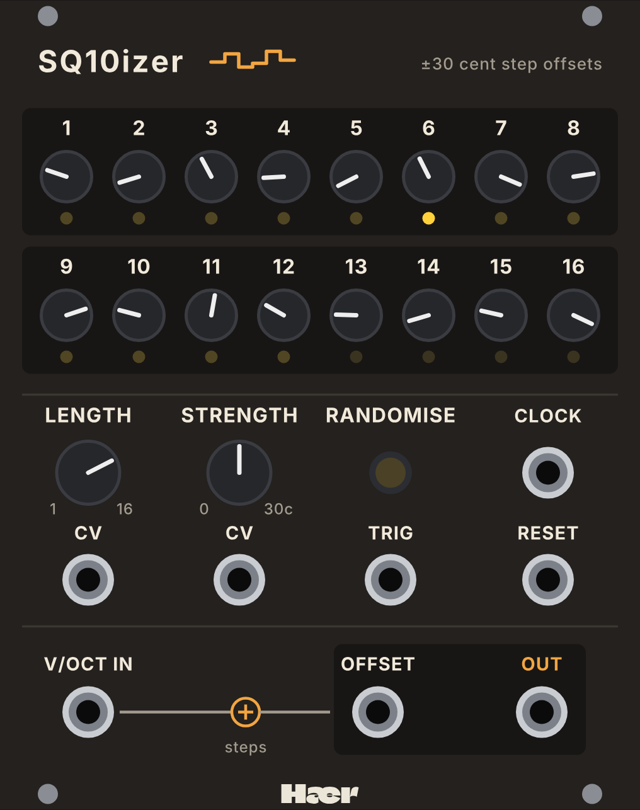

# SQ10izer

A VCV Rack module by Haer (20 HP). It takes a clock and a V/OCT pitch, and on
every clock adds a small, unquantised offset (up to ±30 cents) from one of 16 steps. A perfectly
quantised sequencer then plays slightly out of tune in a repeating way, like an
early analogue step sequencer where every step's pitch was dialled in by hand
and no two steps were ever quite in tune.



## The panel

| Part | What it does |
|---|---|
| **Steps 1–16** | One knob per step, from −30 cents (full left) through in tune (noon) to +30 cents (full right). Hover a knob to read its exact offset; double-click to put it back in tune. The light under each knob shows the playing step; steps inside the loop glow faintly. |
| **LENGTH** + CV | Where the pattern loops, 1 to 16 steps. The CV adds 1.5 steps per volt. |
| **STRENGTH** + CV | How strong RANDOMISE is: the furthest any step can land from in tune, 0 to 30 cents (starts at 15). At 5 cents you get a faint shimmer, at 30 a properly drunk sequencer. The CV adds 3 cents per volt. STRENGTH only matters at the moment you randomise; it doesn't change steps already set. |
| **RANDOMISE** button + TRIG | Sets the step knobs to new random values within ±STRENGTH. The knobs really move, so you can then fine-tune any step by hand. |
| **CLOCK** | Each trigger moves on one step. Use the same clock as the sequencer feeding V/OCT IN. |
| **RESET** | Back to the start: the next clock plays step 1. |
| **V/OCT IN** | The pitch to wobble. Polyphonic is fine: every voice gets the same offset. Nothing plugged in = the offsets on their own. |
| **OFFSET** | Just the step offset as a voltage (no input pitch added). |
| **OUT** | V/OCT IN plus the step offset. |

## Right-click options

- **Gentle random**: random values are mostly small with the odd bigger one, instead of evenly spread.
- **RANDOMISE only changes steps inside LENGTH**: keeps the steps past the loop point as they are.
- **Zero all steps**: every step back to in tune.

Rack's own **Randomize** (Ctrl/Cmd-R) also randomises the steps but leaves STRENGTH and LENGTH alone (and uses the full ±30 cents).

## Patch ideas

1. **Basic SQ wobble.** Clock into your sequencer and into SQ10izer's CLOCK. Sequencer pitch into V/OCT IN, OUT into the oscillator. STRENGTH around 10 to 20 cents, press RANDOMISE until it sounds right, then nudge single steps.
2. **Out-of-phase loops.** Set LENGTH to something that doesn't match the sequence (sequence 16, SQ10izer 7 or 5). The same notes come round with a different tuning each time, which slowly shifts the feel without changing the melody.
3. **Drift over a track.** A slow ramp into STRENGTH CV and a clock divider into TRIG: each re-roll gets a little wilder, so the tuning creeps further out through a breakdown. Zero the steps (right-click) for the drop.
4. **Mutating pattern.** A slow clock divider (every 8 or 16 bars) into RANDOMISE TRIG with *Gentle random* on: the tuning pattern re-rolls now and then while the notes stay put.
5. **Chords that beat.** Poly chord into V/OCT IN: the whole chord moves together. For a looser chord, use OFFSET into a second oscillator's fine-tune or FM input instead.

## Building

```
python3 res/make_panel.py        # panel -> res/SQ10izer.svg (needs fonttools + Inter)
python3 tools/preview.py out.png # mock-up picture of the panel
make dist RACK_DIR=...           # or let GitHub Actions build it
```

The version stays 2.x: Rack 2 skips plugins numbered 3.x.
